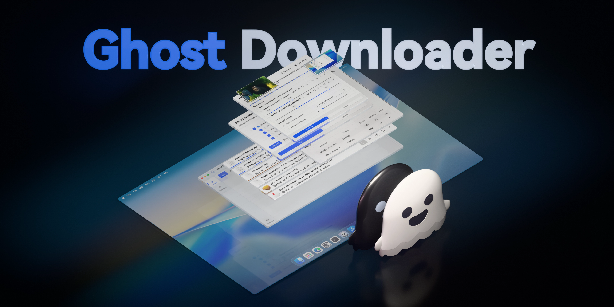
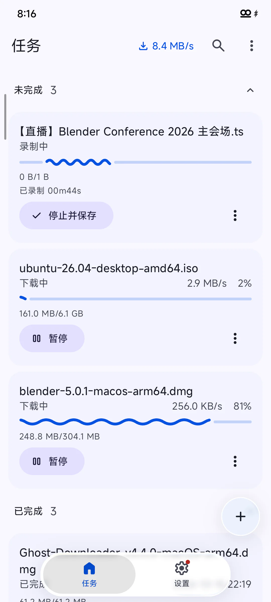
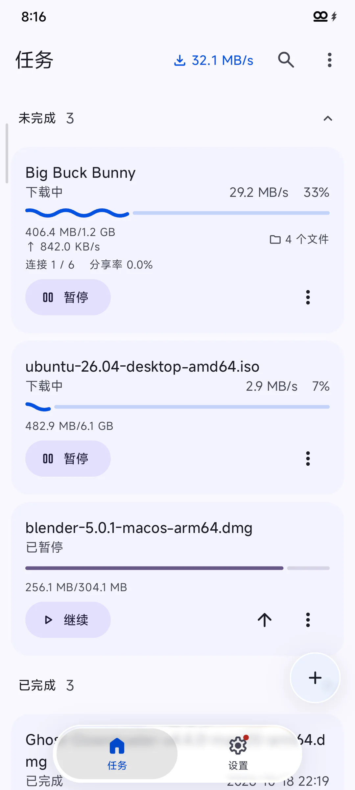
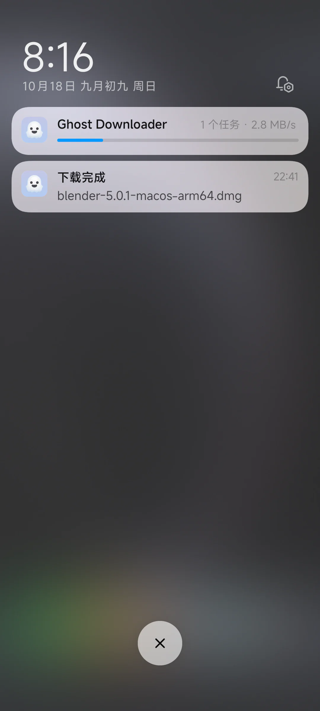

<!-- PROJECT LOGO -->

  
## The only downloader you need

<!-- FEATURES -->
## Features

* **Fast where it matters.** Every downloader is fast on a good connection. The real test is a bad one. Smart chunking without file merging. Auto-detects bandwidth. Real-browser TLS fingerprints, invisible to anti-bot checks.
* **One app instead of five.** Everything in one place, nothing watered down. `HTTP`, `Magnet/BT`, `FTP`, `M3U8`, `MPEG-DASH`, `eD2k`. `YouTube` and `Bilibili` with clip selection, any quality and subtitles, playlists and multi-part episodes. `GitHub` and `HuggingFace` with mirror acceleration.
* **See it. Sniff it. Download it.** A download button follows the video, any quality you want. The extension popup lists every medium on the page. Click it there, or just download as you normally would, the desktop app takes over seamlessly. No copying links, and authentication state carries over.
* **Native on every platform.** It shows in the details. One app, four systems, native experience everywhere. On Android, it records live M3U8 streams and keeps downloading in the background.
* **Always in control** Effortlessly. `aria2`-compatible RPC API for third-party tools. Change the URL, headers, or proxy mid-download. Progress is never lost.

<!-- ABOUT THE PROJECT -->
## About The Project

Started as a passion project to help a Bilibili creator manage resources. Now it ships on four platforms, handles virtually every download protocol, and has a growing Feature Packs plugin ecosystem.

| Platform | Required Version | Architectures |
|:--|:--|:--|
|  **Windows** | `10+` | `x86_64` / `arm64` |
|  **macOS** | `13.0+` | `x86_64` / `arm64` |
|  **Linux** | `glibc 2.35+` | `x86_64` / `arm64` |
|  **Android** | `9.0+` | `arm64-v8a` |

## Install

[View all releases](../../releases)

| Platform | Download | Run |
|----------|----------|-----|
| **Windows x64** | [ghost-downloader-x64.7z](../../releases) | Run installer → launch `ghost-downloader-x64.7z` |
| **Linux x64** | [ghost-downloader-Linux-x64.run](../../releases) | `chmod +x` → run installer |
| **macOS Apple Silicon** | [ghost-downloader-macOS-arm64.dmg](../../releases) | Open DMG → drag to Applications |

<!-- SCREEN SHOTS -->
## Screenshots

https://github.com/user-attachments/assets/d97dc8c9-f320-4645-8dcd-0d9dc4cf2eab

  <picture>
    <source media="(prefers-color-scheme: dark)" srcset="assets/android-recording-dark.webp" />
    
  </picture>
  <picture>
    <source media="(prefers-color-scheme: dark)" srcset="assets/android-tasks-dark.webp" />
    
  </picture>
  <picture>
    <source media="(prefers-color-scheme: dark)" srcset="assets/android-notification-dark.webp" />
    
  </picture>

<!-- COMMAND LINE -->
## Translation

We translate Ghost Downloader on [Crowdin](https://gdi18n.xychr.com). Do not send pull requests that change translation files.

- Your language is not on Crowdin?
- The source text is Simplified Chinese.
- A new language goes into the app when 60% of the desktop text is translated. Text that is not translated shows in English.

<!-- ROADMAP -->
## Roadmap

- [ ] Make the plugin API public (Feature Packs system is operational, API stabilizing)
- [ ] Enhanced task editing, such as binding multiple Sessions to one task

## License

Distributed under the GPL v3.0 License. Open `LICENSE` for more details.

Copyright © 2023-2026 XiaoYouChR.

## Star History

<a href="https://www.star-history.com/?repos=XiaoYouChR%2FGhost-Downloader-3&type=date&legend=top-left">
 <picture>
   <source media="(prefers-color-scheme: dark)" srcset="https://api.star-history.com/chart?repos=XiaoYouChR/Ghost-Downloader-3&type=date&theme=dark&legend=top-left&sealed_token=LFoHRo2s05TZoUPnYwYLjvXVdryi_dHus9oWAnLyuW3tytG-ZJ3cYCralCBqELLNt2yNjh53BVMVdHK2tiwQo9xJZIEIFC46B1sQc8ltFG3qOPVdV1Q2mTLijg4hnxQVSKGKGEgHEV8nrIHdcup8Y2wegyyuFkhoJfA2k9ZDaYorFXAOt-t57jGPBSTk" />
   <source media="(prefers-color-scheme: light)" srcset="https://api.star-history.com/chart?repos=XiaoYouChR/Ghost-Downloader-3&type=date&legend=top-left&sealed_token=LFoHRo2s05TZoUPnYwYLjvXVdryi_dHus9oWAnLyuW3tytG-ZJ3cYCralCBqELLNt2yNjh53BVMVdHK2tiwQo9xJZIEIFC46B1sQc8ltFG3qOPVdV1Q2mTLijg4hnxQVSKGKGEgHEV8nrIHdcup8Y2wegyyuFkhoJfA2k9ZDaYorFXAOt-t57jGPBSTk" />
   
 </picture>
</a>
